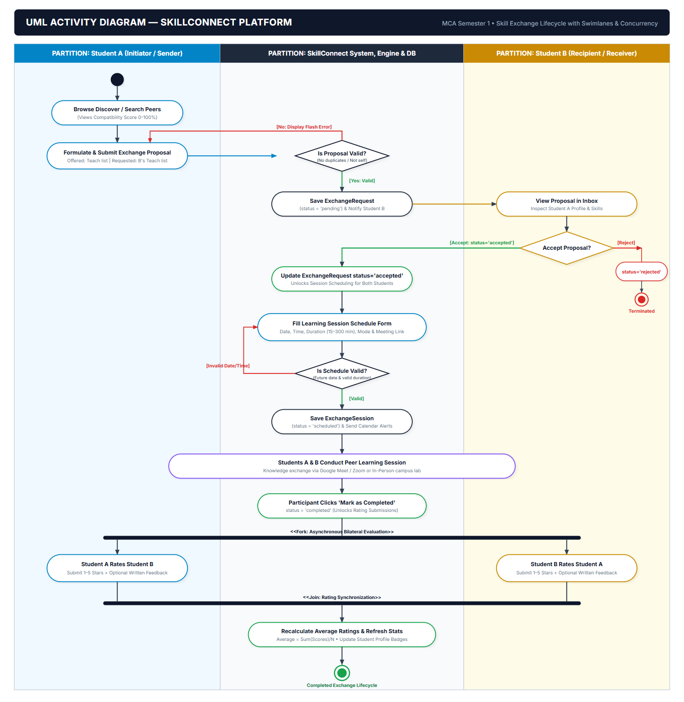
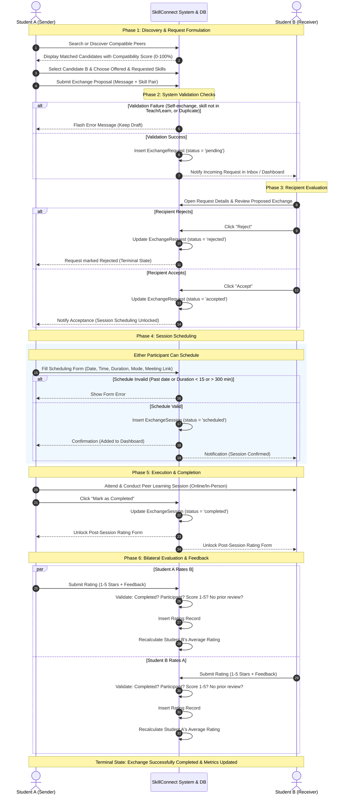
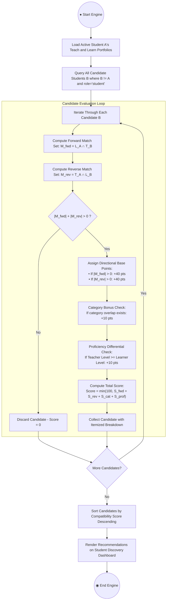

# SkillConnect — UML Activity Diagram Specification
**Academic Level:** MCA Semester 1 — Python Mini Project  
**System Boundary:** `SkillConnect Platform`  
**Pattern:** UML 2.5 Activity Diagrams with Partitions (Swimlanes), Decision Nodes, and State Progression  
**Current Baseline:** Fully implemented & verified (91/91 unit/integration tests passing)

---

## 1. Overview
An **Activity Diagram** describes the dynamic flow of control and data between actors and system components. In SkillConnect, the two primary business workflows modeled are:

1. **Primary Workflow: End-to-End Skill Exchange Lifecycle**  
   From candidate discovery, proposal validation, and recipient decision, to session scheduling, completion, and reciprocal peer review submission.
2. **Algorithmic Workflow: Deterministic Reciprocal Matching Engine**  
   Step-by-step mathematical evaluation of complementary portfolios, scoring rules, proficiency bonuses, and ranking.

- **High-Resolution PNG:** [activity_diagram.png](activity_diagram.png) (Swimlane Activity Diagram)
- **Scalable Vector Graphic:** [activity_diagram.svg](activity_diagram.svg)
- **PlantUML Source:** [activity_diagram.puml](activity_diagram.puml)

---

## 2. Primary Activity Diagram: End-to-End Skill Exchange Lifecycle

This diagram uses **Swimlanes (Partitions)** to clearly separate responsibilities between:
- **Student A (Sender / Learner / Teacher)**
- **SkillConnect System & Database**
- **Student B (Receiver / Partner)**

---

## 3. Detailed Swimlane Activity Flow (Flowchart Format)

```mermaid
flowchart TD
    %% Initial Node
    StartNode((● Start)) --> A_Browse[Student A: Browse Discovery / Student Search]

    %% Swimlane Partition 1: Student A
    subgraph Swimlane_A ["Partition: Student A (Sender)"]
        A_Browse --> A_Select[Select Compatible Peer Student B]
        A_Select --> A_FillForm[Choose Offered Skill from Teach Portfolio<br/>& Requested Skill from Candidate's Teach Portfolio]
        A_FillForm --> A_Submit[Submit Exchange Proposal]
    end

    %% Swimlane Partition 2: System Validation
    subgraph Swimlane_System ["Partition: SkillConnect Platform & Engine"]
        A_Submit --> Sys_Validate{System: Validate Proposal Prerequisites}
        Sys_Validate -- "Invalid (Self-req / Skill mismatch / Duplicate)" --> Sys_Err[Display Validation Error]
        Sys_Err --> A_FillForm
        
        Sys_Validate -- "Valid" --> Sys_SavePending[Save ExchangeRequest with status='pending']
        Sys_SavePending --> Sys_NotifyB[Dispatch Notification / Update Receiver Inbox]
    end

    %% Swimlane Partition 3: Student B
    subgraph Swimlane_B ["Partition: Student B (Receiver)"]
        Sys_NotifyB --> B_Review[Student B: Review Exchange Request Details]
        B_Review --> B_Decision{Student B Decision}
        
        B_Decision -- "Reject" --> B_RejectAction[Click 'Reject Request']
        B_Decision -- "Accept" --> B_AcceptAction[Click 'Accept Request']
    end

    %% Resolution Paths
    B_RejectAction --> Sys_SetRejected[System: Update ExchangeRequest status='rejected']
    Sys_SetRejected --> End_Rejected((◉ End Rejected))

    B_AcceptAction --> Sys_SetAccepted[System: Update ExchangeRequest status='accepted']
    
    %% Session Scheduling
    Sys_SetAccepted --> AB_Schedule[Either Participant: Fill Session Schedule Form<br/>Date, Time, Duration 15-300m, Mode, Link]
    AB_Schedule --> Sys_ValidSess{System: Validate Date & Duration}
    Sys_ValidSess -- "Past Date / Invalid Duration" --> AB_Schedule
    Sys_ValidSess -- "Valid" --> Sys_SaveSess[Save ExchangeSession with status='scheduled']

    %% Execution
    Sys_SaveSess --> AB_Conduct[Participants: Conduct Peer Learning Session]
    AB_Conduct --> AB_Complete[Participant: Click 'Mark Completed']
    AB_Complete --> Sys_SetCompleted[System: Update ExchangeSession status='completed']

    %% Rating Phase (Parallel / Concurrent)
    Sys_SetCompleted --> Fork_Rating{Fork}
    
    Fork_Rating --> Rate_A[Student A: Submit 1-5 Star Review for B]
    Fork_Rating --> Rate_B[Student B: Submit 1-5 Star Review for A]

    Rate_A --> Sys_SaveRatingA[System: Verify & Save Rating<br/>Recalculate B's Average Rating]
    Rate_B --> Sys_SaveRatingB[System: Verify & Save Rating<br/>Recalculate A's Average Rating]

    Sys_SaveRatingA --> Join_Rating{Join}
    Sys_SaveRatingB --> Join_Rating

    Join_Rating --> Sys_UpdateStats[System: Update Activity Summaries & Badges]
    Sys_UpdateStats --> End_Success((◉ End Completed))
```

---

## 4. Secondary Activity Diagram: Reciprocal Matching Engine Workflow

---

## 5. Formal UML Element Mapping for Viva Presentation

| UML Element | Representation in SkillConnect | Function in Workflow |
|---|---|---|
| **Initial Node (`●`)** | User initiates discovery or clicks "Request Exchange". | Starting point of the activity. |
| **Activity States (Rectangles)** | `Browse Directory`, `Fill Form`, `Validate Proposal`, `Conduct Session`. | Unit of work or operation performed by actor or system. |
| **Partitions / Swimlanes** | `Student A`, `SkillConnect System`, `Student B`. | Clarifies who owns each action. |
| **Decision Nodes (Diamonds)** | `Valid Proposal?`, `Recipient Accept/Reject?`, `Date Valid?`. | Evaluates boolean guard conditions to branch execution. |
| **Fork Node (Horizontal Bar)** | After session marked `completed`. | Splits single control flow into concurrent paths (both users can rate independently). |
| **Join Node (Horizontal Bar)** | Synchronizes independent rating submissions. | Merges parallel streams before final profile and dashboard metrics recalculation. |
| **Final State Node (`◉`)** | Exchange completed and rated, or request rejected. | Terminates the activity lifecycle. |
