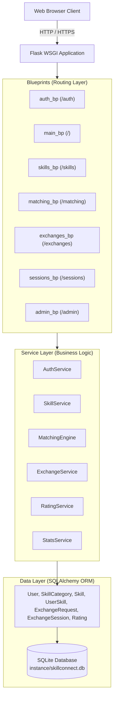

# SkillConnect — Architecture Specification
**Version:** 1.0  
**Project:** SkillConnect — Student Skill Exchange Platform  
**Architecture Pattern:** Layered MVC with Flask Application Factory, Blueprint Modularization & Service Layer

---

## 1. Architectural Philosophy
SkillConnect is engineered to be **production-structured, maintainable, extensible, and clean**, avoiding the monolithic single-file pitfall typical of student projects. It strictly separates concerns:

1. **Presentation Layer:** Jinja2 templates styled with Bootstrap 5, interactive Vanilla JavaScript, and Chart.js for data visualization.
2. **Controller / Routing Layer (Blueprints):** Thin Flask route handlers responsible for HTTP request handling, session authentication checks, input collection, and response dispatching.
3. **Service Layer (Domain Logic):** Dedicated business logic classes encapsulating matching logic, request state machines, session management, and rating computations.
4. **Data Access / Persistence Layer:** SQLAlchemy ORM models with SQLite storage, declarative relationships, foreign keys, and cascading constraints.



---

## 2. Directory Structure
```
Python_Mini_Project_Sem l/
│
├── app/                            # Application package root
│   ├── __init__.py                 # Application factory (create_app)
│   ├── config.py                   # Centralized configuration (Development, Testing, Production)
│   ├── extensions.py               # Instantiated Flask extensions (db, login_manager, csrf)
│   │
│   ├── models/                     # SQLAlchemy ORM Models
│   │   ├── __init__.py
│   │   ├── user.py                 # User model (Student & Admin)
│   │   ├── skill.py                # SkillCategory, Skill, UserSkill models
│   │   ├── exchange.py             # ExchangeRequest, ExchangeSession models
│   │   └── rating.py               # Rating & feedback model
│   │
│   ├── services/                   # Service Layer (Business Logic)
│   │   ├── __init__.py
│   │   ├── auth_service.py         # Registration, credential verification, profile updates
│   │   ├── skill_service.py        # Skill catalog & user skill portfolio management
│   │   ├── matching_service.py     # Deterministic two-way matching engine
│   │   ├── exchange_service.py     # Exchange requests & session lifecycle state machine
│   │   └── stats_service.py        # Dashboard analytics & platform reporting
│   │
│   ├── forms/                      # WTForms form validations & CSRF definitions
│   │   ├── __init__.py
│   │   ├── auth_forms.py
│   │   ├── skill_forms.py
│   │   ├── exchange_forms.py
│   │   └── admin_forms.py
│   │
│   ├── routes/                     # Blueprint Route Controllers
│   │   ├── __init__.py
│   │   ├── auth.py                 # Authentication routes (/auth/login, /auth/register)
│   │   ├── main.py                 # Home, dashboard, public directory, profile
│   │   ├── skills.py               # Skill portfolio CRUD
│   │   ├── matching.py             # Match recommendations & compatibility breakdown
│   │   ├── exchanges.py            # Proposals & session scheduling
│   │   └── admin.py                # Platform administration & stats
│   │
│   ├── static/                     # Static Web Assets
│   │   ├── css/
│   │   │   └── custom.css          # Custom aesthetic stylesheet & styling tokens
│   │   └── js/
│   │       ├── main.js             # General interactive client scripting
│   │       └── dashboard-charts.js # Chart.js visualizations
│   │
│   └── templates/                  # Jinja2 HTML Templates
│       ├── base.html               # Master layout with responsive navbar & footer
│       ├── auth/                   # Login, register templates
│       ├── main/                   # Index landing, dashboard, directory, profile
│       ├── skills/                 # Manage skills, add/edit modals
│       ├── matching/               # Matching recommendations & breakdown
│       ├── exchanges/              # Requests list, session scheduling, detail view
│       ├── reviews/                # Session completion & rating submission modal/page
│       ├── admin/                  # Admin dashboard & category management
│       └── errors/                 # 404, 403, 500 error pages
│
├── docs/                           # Documentation
│   ├── requirements.md
│   ├── use_case_diagram.md
│   ├── use_case_diagram.svg
│   ├── use_case_diagram.puml
│   ├── use_case_diagram.mmd
│   ├── architecture.md
│   ├── database_design.md
│   ├── matching_algorithm.md
│   └── test_plan.md
│
├── tests/                          # Automated Pytest Suite
│   ├── conftest.py                 # Pytest fixtures, test database, test clients
│   ├── test_auth.py                # Authentication, hashing, access control tests
│   ├── test_skills.py              # Skill CRUD, ownership enforcement tests
│   ├── test_matching.py            # Matching algorithm unit & edge case tests
│   ├── test_exchanges.py           # Exchange & session state machine tests
│   ├── test_ratings.py             # Rating validation & duplicate prevention tests
│   └── test_admin.py               # Admin role authorization & stats tests
│
├── .env.example                    # Environment variable template
├── .gitignore                      # Git ignore patterns
├── README.md                       # Comprehensive setup and user guide
├── requirements.txt                # Pinned dependency requirements
└── run.py                          # Application entry point & CLI commands (seed, init-db)
```

---

## 3. Application Lifecycle & Startup
- The application is instantiated via `create_app(config_name=None)` defined in `app/__init__.py`.
- Flask extensions (`SQLAlchemy`, `LoginManager`, `CSRFProtect`) are decoupled from the application instance and initialized via `init_app(app)`.
- Blueprints are registered with distinct URL prefixes (`/auth`, `/skills`, `/matching`, `/exchanges`, `/admin`).
- Database initialization and seeding are exposed as safe CLI commands (`flask init-db`, `flask seed-data`), ensuring existing user data is never wiped automatically on server start.

---

## 4. Extensibility & Future Readiness
The modular architecture guarantees that future modules (e.g., Real-time Chat, Video Call WebRTC integration, In-App Notifications, Badge / Gamification system) can be added cleanly as new blueprints and models without refactoring the five foundational modules.
