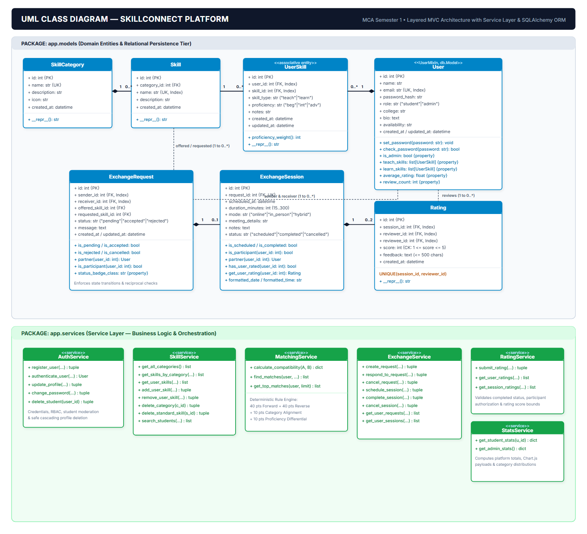
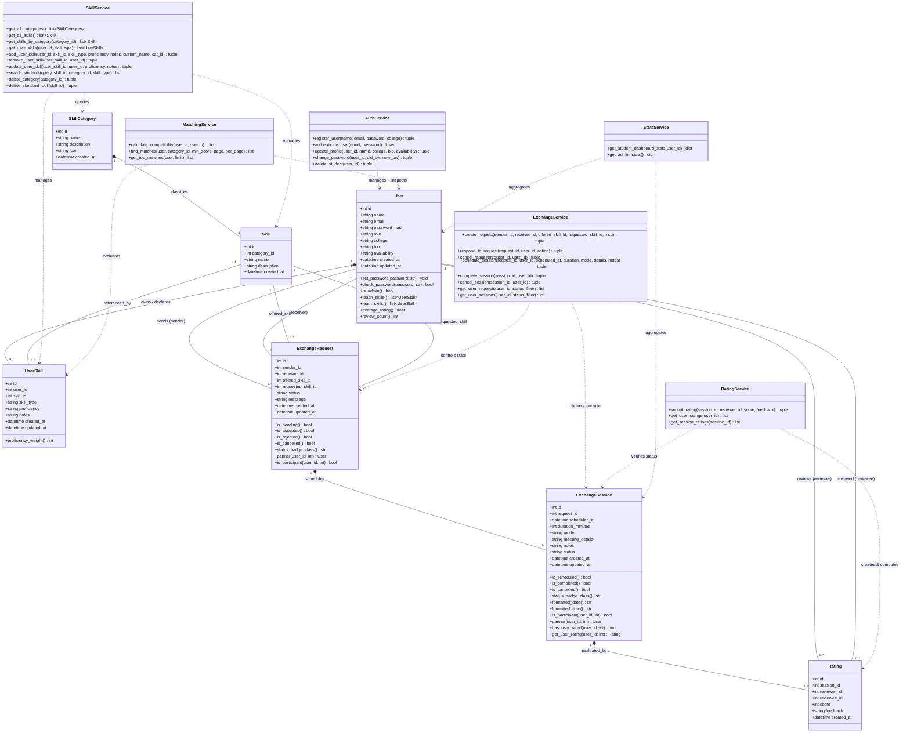

# SkillConnect — UML Class Diagram Specification
**Academic Level:** MCA Semester 1 — Python Mini Project  
**System Boundary:** `SkillConnect Platform`  
**Pattern:** Layered MVC Architecture with Service Layer & SQLAlchemy ORM  
**Current Baseline:** Fully implemented & verified (96/96 unit/integration tests passing)

---

## 1. Overview
The **SkillConnect Class Diagram** models the static structure of the application. It captures:
1. **Domain Entities (Data Layer):** SQLAlchemy ORM models mapped directly to normalized relational tables (3NF).
2. **Service Layer (Domain Logic):** Dedicated business logic classes encapsulating matching logic, request state machines, session management, and rating computations.
3. **Relationships & Multiplicities:** 1-to-1, 1-to-many, composition, associative entities, and service-to-model dependencies.

- **High-Resolution PNG:** [class_diagram.png](class_diagram.png) (UML Class Diagram)
- **Scalable Vector Graphic:** [class_diagram.svg](class_diagram.svg)
- **PlantUML Source:** [class_diagram.puml](class_diagram.puml)

---

## 2. Mermaid Class Diagram

---

## 3. Structural Analysis of Key Classes

### 3.1 Domain Entity Layer

#### 1. `User` (extends `UserMixin`, `db.Model`)
- **Responsibility:** Represents authenticated actors (students and admins).
- **Key Attributes:** `id`, `name`, `email` (unique index), `password_hash`, `role` (`student` or `admin`), `college`, `bio`, `availability`.
- **Key Methods / Properties:**
  - `set_password(password)`: Hashes plaintext password using `werkzeug.security`.
  - `check_password(password)`: Verifies candidate credentials.
  - `is_admin`: Boolean flag for administrative RBAC.
  - `teach_skills`: Dynamic filter for user skills marked with `skill_type = 'teach'`.
  - `learn_skills`: Dynamic filter for user skills marked with `skill_type = 'learn'`.
  - `average_rating`: Aggregates received ratings rounded to 1 decimal place.

#### 2. `SkillCategory` & `Skill`
- **Responsibility:** Normalized catalog taxonomy.
- **Multiplicity:** 1 `SkillCategory` contains $0..*$ `Skill`s (`cascade="all, delete-orphan"`).
- **Attributes:** Unique category names, UI Bootstrap icons, normalized skill names indexed for rapid search.

#### 3. `UserSkill` (Associative Entity)
- **Responsibility:** Models the Many-to-Many relationship between `User` and `Skill` with rich attributes.
- **Attributes:** `skill_type` (`teach` or `learn`), `proficiency` (`beginner`, `intermediate`, `advanced`), `notes`.
- **Unique Constraint:** `(user_id, skill_id, skill_type)` ensures a student cannot add the exact same skill twice for the same portfolio role.
- **Method:** `proficiency_weight` maps strings to ordinal weights (1, 2, 3) for algorithmic ranking.

#### 4. `ExchangeRequest`
- **Responsibility:** Bilateral skill exchange contract proposal.
- **State Machine:** `status IN ('pending', 'accepted', 'rejected', 'cancelled')`.
- **Foreign Keys:** `sender_id`, `receiver_id`, `offered_skill_id`, `requested_skill_id`.
- **Methods:** `partner(current_user_id)`, `is_participant(user_id)`.

#### 5. `ExchangeSession`
- **Responsibility:** Temporal scheduling and fulfillment of an accepted exchange.
- **Multiplicity:** Strict 1-to-1 relationship with `ExchangeRequest` via unique foreign key `request_id`.
- **State Machine:** `status IN ('scheduled', 'completed', 'cancelled')`.
- **Methods:** `is_participant(user_id)`, `has_user_rated(user_id)`, `get_user_rating(user_id)`.

#### 6. `Rating`
- **Responsibility:** Bilateral evaluation and feedback after session completion.
- **Constraints:**
  - Check constraint: `1 <= score <= 5`.
  - Unique constraint: `(session_id, reviewer_id)` prevents ballot stuffing.
- **Multiplicity:** At most 2 ratings per session (one from each participant).

---

## 4. Multiplicity Summary Table

| Relationship | Type | Multiplicity | Rationale |
|---|---|---|---|
| `User` $\rightarrow$ `UserSkill` | Composition | $1 \text{ to } 0..*$ | Deleting a user cascades and removes their skill portfolio. |
| `SkillCategory` $\rightarrow$ `Skill` | Composition | $1 \text{ to } 0..*$ | Deleting a category removes all its classified skills. |
| `Skill` $\rightarrow$ `UserSkill` | Association | $1 \text{ to } 0..*$ | A skill can be offered or sought by many students. |
| `User` $\rightarrow$ `ExchangeRequest` | Association | $1 \text{ to } 0..*$ | A student can send and receive multiple exchange requests. |
| `ExchangeRequest` $\rightarrow$ `ExchangeSession` | Composition | $1 \text{ to } 0..1$ | An accepted request has at most one active session schedule. |
| `ExchangeSession` $\rightarrow$ `Rating` | Composition | $1 \text{ to } 0..2$ | Each completed session allows at most 1 rating per participant. |
| `User` $\rightarrow$ `Rating` | Association | $1 \text{ to } 0..*$ | A user accumulates ratings as reviewer and reviewee. |
