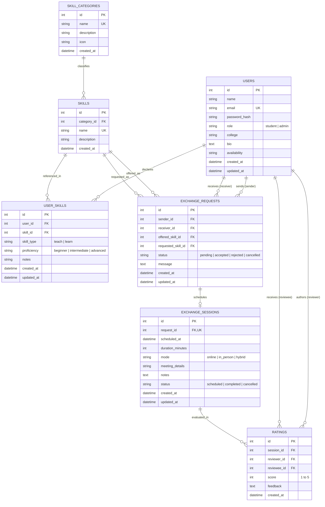

# SkillConnect — Database Design & Schema Specification
**Version:** 1.0  
**Database Engine:** SQLite 3  
**ORM:** SQLAlchemy 2.0+ via Flask-SQLAlchemy 3.1+  

---

## 1. Overview & Normalization Strategy
The SkillConnect database is designed following **Third Normal Form (3NF)** principles to guarantee data integrity, eliminate redundancy, and maintain explicit relational semantics:
- Skills are not stored as unparsed comma-separated strings; each skill is an independent entity associated with a categorized taxonomy.
- A student's skill offerings and learning objectives are distinct records in `user_skills`, allowing students to specify different proficiencies and custom notes.
- Skill exchanges, scheduled sessions, and post-session evaluations are separated into distinct lifecycle tables with strict relational foreign keys.

---

## 2. Entity-Relationship (ER) Diagram

---

## 3. Data Dictionary & Table Schemas

### 3.1 `users` Table
Stores student and administrator credentials, profiles, and roles.
| Column | Type | Constraints | Description |
| :--- | :--- | :--- | :--- |
| `id` | INTEGER | PRIMARY KEY, AUTOINCREMENT | Unique user identifier |
| `name` | VARCHAR(120) | NOT NULL | Full name of the student or administrator |
| `email` | VARCHAR(180) | NOT NULL, UNIQUE, INDEXED | Email address (login username) |
| `password_hash` | VARCHAR(255) | NOT NULL | Werkzeug-salted password hash |
| `role` | VARCHAR(20) | NOT NULL, DEFAULT 'student' | Role: `'student'` or `'admin'` |
| `college` | VARCHAR(180) | NULLABLE | University / College institution name |
| `bio` | TEXT | NULLABLE | Self-introduction and learning interests |
| `availability` | VARCHAR(120) | NULLABLE | High-level schedule (e.g. "Weekends & Evenings") |
| `created_at` | DATETIME | NOT NULL, DEFAULT UTC_NOW | Registration timestamp |
| `updated_at` | DATETIME | NOT NULL, DEFAULT UTC_NOW | Last profile update timestamp |

### 3.2 `skill_categories` Table
Standard taxonomy groupings for organizing skills.
| Column | Type | Constraints | Description |
| :--- | :--- | :--- | :--- |
| `id` | INTEGER | PRIMARY KEY, AUTOINCREMENT | Category ID |
| `name` | VARCHAR(80) | NOT NULL, UNIQUE | Category name (e.g., "Programming & Tech") |
| `description` | VARCHAR(255) | NULLABLE | Summary of skills in this category |
| `icon` | VARCHAR(50) | NOT NULL, DEFAULT 'bi-tag' | Bootstrap icon class for UI rendering |
| `created_at` | DATETIME | NOT NULL, DEFAULT UTC_NOW | Creation timestamp |

### 3.3 `skills` Table
Standardized list of skills available on the platform.
| Column | Type | Constraints | Description |
| :--- | :--- | :--- | :--- |
| `id` | INTEGER | PRIMARY KEY, AUTOINCREMENT | Skill ID |
| `category_id` | INTEGER | NOT NULL, FOREIGN KEY(`skill_categories.id`) | Owning category |
| `name` | VARCHAR(100) | NOT NULL, UNIQUE, INDEXED | Skill name (e.g., "Python", "Figma", "Public Speaking") |
| `description` | VARCHAR(255) | NULLABLE | Brief explanation of the skill |
| `created_at` | DATETIME | NOT NULL, DEFAULT UTC_NOW | Creation timestamp |

### 3.4 `user_skills` Table
Junction table mapping users to skills with teaching/learning intent and proficiency.
| Column | Type | Constraints | Description |
| :--- | :--- | :--- | :--- |
| `id` | INTEGER | PRIMARY KEY, AUTOINCREMENT | User skill link ID |
| `user_id` | INTEGER | NOT NULL, FOREIGN KEY(`users.id`), INDEXED | Student user ID |
| `skill_id` | INTEGER | NOT NULL, FOREIGN KEY(`skills.id`), INDEXED | Referenced skill ID |
| `skill_type` | VARCHAR(10) | NOT NULL | Intent: `'teach'` or `'learn'` |
| `proficiency` | VARCHAR(20) | NOT NULL, DEFAULT 'intermediate' | Expertise: `'beginner'`, `'intermediate'`, `'advanced'` |
| `notes` | VARCHAR(255) | NULLABLE | Specific subtopics or focus areas |
| `created_at` | DATETIME | NOT NULL, DEFAULT UTC_NOW | Creation timestamp |
| `updated_at` | DATETIME | NOT NULL, DEFAULT UTC_NOW | Last update timestamp |
*Table Constraint:* `UNIQUE(user_id, skill_id, skill_type)` ensures a user cannot register the same skill twice under the same intent.

### 3.5 `exchange_requests` Table
Represents bilateral skill exchange proposals initiated by one student to another.
| Column | Type | Constraints | Description |
| :--- | :--- | :--- | :--- |
| `id` | INTEGER | PRIMARY KEY, AUTOINCREMENT | Request ID |
| `sender_id` | INTEGER | NOT NULL, FOREIGN KEY(`users.id`), INDEXED | Initiator user ID |
| `receiver_id` | INTEGER | NOT NULL, FOREIGN KEY(`users.id`), INDEXED | Target peer user ID |
| `offered_skill_id` | INTEGER | NOT NULL, FOREIGN KEY(`skills.id`) | Skill the sender promises to teach |
| `requested_skill_id`| INTEGER | NOT NULL, FOREIGN KEY(`skills.id`) | Skill the sender desires to learn |
| `status` | VARCHAR(20) | NOT NULL, DEFAULT 'pending' | `'pending'`, `'accepted'`, `'rejected'`, `'cancelled'` |
| `message` | TEXT | NULLABLE | Personal introductory note |
| `created_at` | DATETIME | NOT NULL, DEFAULT UTC_NOW | Creation timestamp |
| `updated_at` | DATETIME | NOT NULL, DEFAULT UTC_NOW | Status change timestamp |
*Table Constraints:* Check constraint `sender_id != receiver_id` prevents self-proposals.

### 3.6 `exchange_sessions` Table
Scheduled learning sessions stemming from accepted exchange requests.
| Column | Type | Constraints | Description |
| :--- | :--- | :--- | :--- |
| `id` | INTEGER | PRIMARY KEY, AUTOINCREMENT | Session ID |
| `request_id` | INTEGER | NOT NULL, UNIQUE, FOREIGN KEY(`exchange_requests.id`) | Linked accepted request |
| `scheduled_at` | DATETIME | NOT NULL | Date and time of meeting |
| `duration_minutes` | INTEGER | NOT NULL, DEFAULT 60 | Planned session length |
| `mode` | VARCHAR(20) | NOT NULL, DEFAULT 'online' | `'online'`, `'in_person'`, `'hybrid'` |
| `meeting_details` | VARCHAR(255) | NULLABLE | Video call link or campus room location |
| `notes` | TEXT | NULLABLE | Session agenda or preparation guidelines |
| `status` | VARCHAR(20) | NOT NULL, DEFAULT 'scheduled' | `'scheduled'`, `'completed'`, `'cancelled'` |
| `created_at` | DATETIME | NOT NULL, DEFAULT UTC_NOW | Scheduling timestamp |
| `updated_at` | DATETIME | NOT NULL, DEFAULT UTC_NOW | Last state update timestamp |

### 3.7 `ratings` Table
Stores post-session peer evaluations and feedback.
| Column | Type | Constraints | Description |
| :--- | :--- | :--- | :--- |
| `id` | INTEGER | PRIMARY KEY, AUTOINCREMENT | Rating ID |
| `session_id` | INTEGER | NOT NULL, FOREIGN KEY(`exchange_sessions.id`), INDEXED | Completed session ID |
| `reviewer_id` | INTEGER | NOT NULL, FOREIGN KEY(`users.id`), INDEXED | Student giving the rating |
| `reviewee_id` | INTEGER | NOT NULL, FOREIGN KEY(`users.id`), INDEXED | Student receiving the rating |
| `score` | INTEGER | NOT NULL, CHECK(`score` BETWEEN 1 AND 5) | Integer star rating 1 to 5 |
| `feedback` | TEXT | NULLABLE | Written qualitative review |
| `created_at` | DATETIME | NOT NULL, DEFAULT UTC_NOW | Submission timestamp |
*Table Constraint:* `UNIQUE(session_id, reviewer_id)` guarantees each participant can submit at most one rating per session exchange.

---

## 4. Integrity, Setup & Upgrade Strategy

### 4.1 Initial Setup Mechanism
- Database engine: SQLite 3 stored locally at `instance/skillconnect.db`.
- Safe initialization: Running `flask --app run.py init-db` invokes `db.create_all()` within application context.
- **Non-Destructive Guarantee:** Existing database files are never dropped, reset, or truncated on startup or initialization.

### 4.2 Phase 2 Implemented Schema
- Tables active in Phase 2:
  1. `users` (Full schema active with authentication and profile fields)
  2. `skill_categories` (Established to enforce relational taxonomy)
  3. `skills` (Established with foreign key to `skill_categories.id`)

### 4.3 Safe Schema Upgrade Strategy for Future Phases
- As development progresses into Phase 3 (UserSkill), Phase 4 (ExchangeRequest & ExchangeSession), and Phase 5 (Rating):
  1. The existing `users` table already defines foreign key targets and cascading rules so no breaking changes or data loss will occur on the `users` table.
  2. Future tables can be added incrementally via `db.create_all()` (which creates new tables while leaving existing tables untouched).
  3. For production deployments with altering existing columns, Flask-Migrate (Alembic) can be introduced to manage versioned migration scripts without manual SQL edits.
