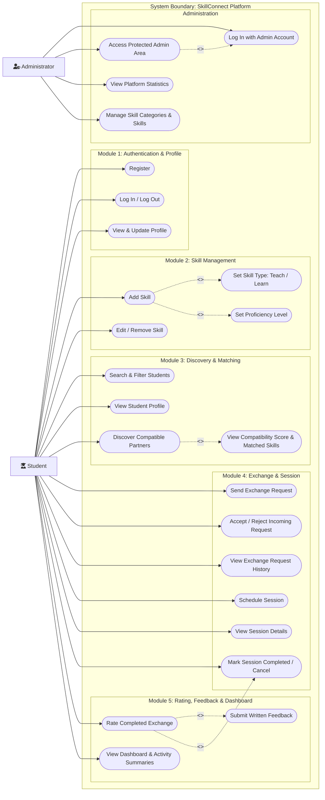

# SkillConnect — UML Use Case Diagram Specification
**Version:** 1.0  
**Project:** SkillConnect — Student Skill Exchange Platform  
**System Boundary:** `SkillConnect`

---

## 1. Overview
The **SkillConnect UML Use Case Diagram** models the functional interactions between external actors and the SkillConnect application boundary. The diagram captures all user-facing requirements across the five core application modules and the administration tier.

### Visual Diagram
A rendered, vector-quality SVG diagram is available at [use_case_diagram.svg](use_case_diagram.svg).  
The editable PlantUML source is stored at [use_case_diagram.puml](use_case_diagram.puml).  
The editable Mermaid source is stored at [use_case_diagram.mmd](use_case_diagram.mmd).

---

## 2. Actors & Primary Roles

### 2.1 Student Actor
- **Description:** A verified student enrolled in an academic institution who teaches acquired skills and learns desired skills from peers.
- **Goals:** Find complementary skill partners, negotiate bilateral learning exchanges, attend scheduled sessions, build peer reputation, and track personal development.

### 2.2 Administrator Actor
- **Description:** An authenticated administrative staff member responsible for platform oversight, statistics monitoring, and skill taxonomy maintenance.
- **Goals:** Ensure platform integrity, monitor engagement metrics, and organize skill categories.

---

## 3. Detailed Use Case Specifications by Module

### Module 1: User Authentication & Profile
| Use Case ID | Name | Actor | Description |
| :--- | :--- | :--- | :--- |
| **UC-101** | Register | Student | Student enters personal details (name, email, password, college) to create a new platform account. |
| **UC-102** | Log In & Log Out | Student / Admin | Verifies hashed credentials and establishes an authenticated session via Flask-Login. |
| **UC-103** | View & Update Profile | Student | Allows the student to manage bio, academic institution, and schedule availability. |

### Module 2: Skill Management
| Use Case ID | Name | Actor | Description |
| :--- | :--- | :--- | :--- |
| **UC-201** | Add Skill | Student | Associates a standardized skill with the student's profile. Includes setting type and proficiency. |
| **UC-202** | Edit / Remove Skill | Student | Updates proficiency/notes or deletes an existing skill association owned by the student. |
| **UC-203** | Set Teach / Learn Type | Student | *<<include>>* Defines whether the skill is being offered (`Teach`) or requested (`Learn`). |
| **UC-204** | Set Proficiency Level | Student | *<<include>>* Declares expertise (`Beginner`, `Intermediate`, `Advanced`). |

### Module 3: Skill Discovery & Matching
| Use Case ID | Name | Actor | Description |
| :--- | :--- | :--- | :--- |
| **UC-301** | Search & Filter Students | Student | Searches peers by skill name, category, and proficiency level. |
| **UC-302** | View Student Profile | Student | Views public academic and skill information of a prospective peer. |
| **UC-303** | Discover Compatible Partners | Student | Triggers the deterministic two-way matching engine to locate bilateral matches. |
| **UC-304** | View Compatibility Score & Matched Skills | Student | *<<include>>* Displays an interpretable 0–100% score and granular matched skills breakdown. |

### Module 4: Skill Exchange & Session
| Use Case ID | Name | Actor | Description |
| :--- | :--- | :--- | :--- |
| **UC-401** | Send Exchange Request | Student | Proposes a reciprocal exchange specifying offered skill, requested skill, and a message. |
| **UC-402** | Accept / Reject Request | Student | Recipient responds to a pending proposal. Acceptance transitions status to `Accepted`. |
| **UC-403** | View Request History | Student | Inspects outgoing and incoming requests categorized by status. |
| **UC-404** | Schedule Session | Student | *<<extend>>* Available once a request is `Accepted`. Sets date, time, mode, and location/link. |
| **UC-405** | View Session Details | Student | Reviews upcoming or historical meeting details and notes. |
| **UC-406** | Mark Session Completed / Cancel | Student | Eligible participants mark finished sessions as `Completed` or abort with `Cancelled`. |

### Module 5: Rating, Feedback & Dashboard
| Use Case ID | Name | Actor | Description |
| :--- | :--- | :--- | :--- |
| **UC-501** | Rate Completed Exchange | Student | *<<extend>>* Triggers only after a session is marked `Completed`. Submits 1–5 star rating. |
| **UC-502** | Submit Written Feedback | Student | *<<include>>* Optional written testimonial alongside the numeric star rating. |
| **UC-503** | View Dashboard & Summaries | Student | Visualizes total skills, matches, upcoming sessions, and Chart.js activity charts. |

### Administration
| Use Case ID | Name | Actor | Description |
| :--- | :--- | :--- | :--- |
| **UC-601** | Admin Authentication | Administrator | Authenticates with administrative credentials to access `/admin`. |
| **UC-602** | Access Protected Admin Area | Administrator | *<<include>>* Guarded by role-based authorization decorator. |
| **UC-603** | View Basic Platform Statistics | Administrator | Summarizes user totals, exchange count, session completions, and platform satisfaction. |
| **UC-604** | Manage Skill Categories & Skills | Administrator | Creates, edits, and audits official platform skill taxonomy. |

---

## 4. Key Relationship Justifications
1. **`<<include>>` (Add Skill $\rightarrow$ Set Type & Set Proficiency):** Adding a skill is not functionally complete without defining whether it is for teaching or learning and establishing proficiency.
2. **`<<include>>` (Discover Compatible Partners $\rightarrow$ View Compatibility Score & Matched Skills):** Partner recommendation is incomplete without displaying the deterministic score and underlying matching skills.
3. **`<<extend>>` (Schedule Session $\rightarrow$ Accept Request):** A session cannot be scheduled arbitrarily; scheduling extends the acceptance of a bilateral exchange proposal.
4. **`<<extend>>` (Rate Completed Exchange $\rightarrow$ Mark Session Completed):** Rating is conditionally enabled only after a session transitions into the `Completed` state.
5. **`<<include>>` (Rate Completed Exchange $\rightarrow$ Submit Written Feedback):** Qualitative review feedback is integrated directly into the exchange evaluation workflow.
