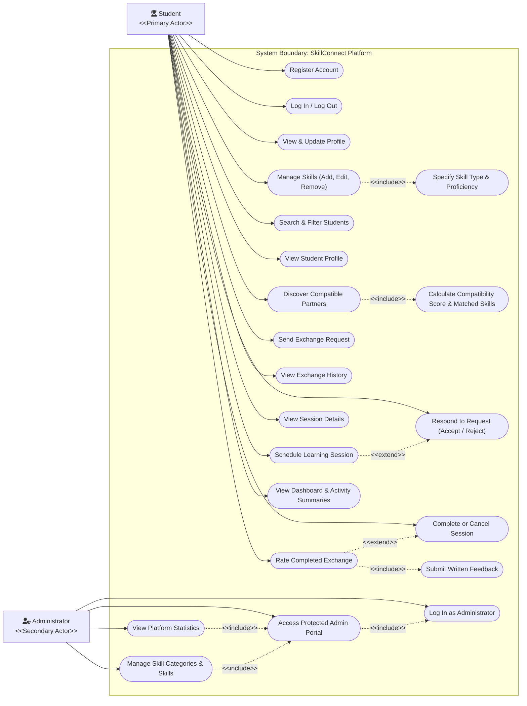

# SkillConnect — UML Use Case Diagram Specification
**Academic Level:** MCA Semester 1 — Python Mini Project  
**System Boundary:** `SkillConnect System`  
**Current Status:** Phase 4 Verified Baseline (Modules 1, 2, 3, and 4 fully implemented and tested)

---

## 1. Overview
This UML Use Case Diagram models the functional interactions between the system actors and the **SkillConnect** platform. It uses clean, standard UML notation without unnecessary numbering prefixes.

- **Visual Vector Diagram:** [use_case_diagram.svg](use_case_diagram.svg)
- **PlantUML Source:** [use_case_diagram.puml](use_case_diagram.puml)
- **Mermaid Source:** [use_case_diagram.mmd](use_case_diagram.mmd)

---

## 2. Actors Description

1. **Student Actor (Primary Actor):**
   The registered peer learner/teacher. Every student can declare skills to teach and skills to learn under a unified profile, search peers, discover bilateral matches, send requests, schedule sessions, and rate peers.
2. **Administrator Actor (Secondary Actor):**
   The college department coordinator or system moderator. Responsible for role-protected oversight, platform usage statistics, and curating official skill categories and skills.

---

## 3. Use Case Descriptions & Implementation Status

| Module | Use Case Name | Actor | Description | Target Phase & Status |
| :--- | :--- | :--- | :--- | :---: |
| **Authentication & Profile** | Register Account | Student | Creates account with name, email, password, and college. | **Phase 2 (Implemented & Tested)** |
| | Log In / Log Out | Student / Admin | Authenticates session via Flask-Login. | **Phase 2 (Implemented & Tested)** |
| | View & Update Profile | Student | Manages bio, college, and availability. | **Phase 2 (Implemented & Tested)** |
| **Skill Management** | Manage Skills | Student | Adds, edits, or deletes skills in personal portfolio. | **Phase 3 (Implemented & Tested)** |
| | Specify Skill Type & Proficiency | Student | *&lt;&lt;include&gt;&gt;* Defines Teach/Learn intent and level. | **Phase 3 (Implemented & Tested)** |
| **Discovery & Matching** | Search & Filter Students | Student | Searches peers by name, category, or proficiency. | **Phase 3 (Implemented & Tested)** |
| | View Student Profile | Student | Inspects a peer's skills, bio, and compatibility overview. | **Phase 3 (Implemented & Tested)** |
| | Discover Compatible Partners | Student | Triggers the rule-based matching engine. | **Phase 3 (Implemented & Tested)** |
| | Calculate Compatibility Score | Student | *&lt;&lt;include&gt;&gt;* Computes 0–100% score and matched skills. | **Phase 3 (Implemented & Tested)** |
| **Exchange & Session** | Send Exchange Request | Student | Proposes a skill exchange to another student. | **Phase 4 (Implemented & Tested)** |
| | Respond to Request | Student | Accepts or rejects incoming requests. | **Phase 4 (Implemented & Tested)** |
| | View Exchange History | Student | Tracks status of incoming and outgoing requests. | **Phase 4 (Implemented & Tested)** |
| | Schedule Learning Session | Student | *&lt;&lt;extend&gt;&gt;* Schedules accepted exchange meetings. | **Phase 4 (Implemented & Tested)** |
| | View Session Details | Student | Reviews meeting link/location and agenda notes. | **Phase 4 (Implemented & Tested)** |
| | Complete or Cancel Session | Student | Concludes, cancels, or reschedules sessions. | **Phase 4 (Implemented & Tested)** |
| **Rating & Dashboard** | Rate Completed Exchange | Student | *&lt;&lt;extend&gt;&gt;* Evaluates completed sessions (1–5 stars). | *Phase 5 (Planned)* |
| | Submit Written Feedback | Student | *&lt;&lt;include&gt;&gt;* Submits review comments. | *Phase 5 (Planned)* |
| | View Dashboard & Analytics | Student | Displays summaries and Chart.js activity charts. | *Phase 5 (Planned)* |
| **Administration** | Log In as Administrator | Admin | Authenticates as admin. | **Phase 2 (Implemented & Tested)** |
| | Access Admin Portal | Admin | Role-protected admin dashboard. | **Phase 2 (Implemented & Tested)** |
| | View Platform Statistics | Admin | Reviews platform-wide usage metrics. | *Phase 5 (Planned)* |
| | Manage Categories & Skills | Admin | Curates official categories and skills taxonomy. | **Phase 3 (Implemented & Tested)** |
